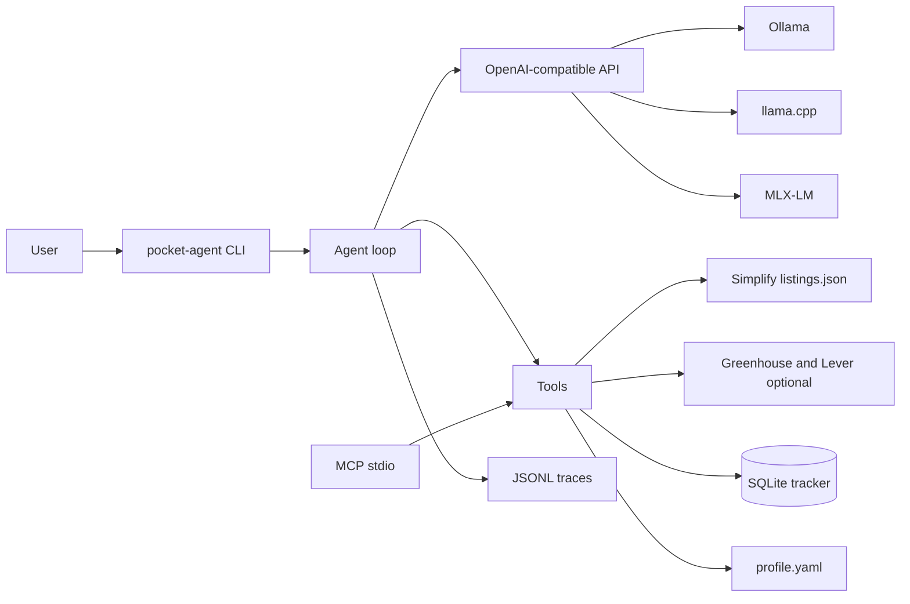

# Pocket Agent

Repository: [github.com/linnkhant07/pocket_agent](https://github.com/linnkhant07/pocket_agent). The Python package and the `pocket-agent` command keep the hyphen. The GitHub repo name is `pocket_agent`.

Pocket Agent is a free, MIT-licensed recruiting assistant that runs on your machine. It reads public job lists, scores them against a local `profile.yaml`, and keeps an application tracker in SQLite. It drafts answers from the profile and asks you when a fact is missing.

It does not submit applications. There is no apply tool.

The default job sources are the two SimplifyJobs lists:

- [SimplifyJobs/New-Grad-Positions](https://github.com/SimplifyJobs/New-Grad-Positions)
- [SimplifyJobs/Summer2027-Internships](https://github.com/SimplifyJobs/Summer2027-Internships)

Both publish `.github/scripts/listings.json`. Pocket Agent uses that file. The README is only a fallback. Greenhouse (`boards-api.greenhouse.io`) and Lever (`api.lever.co`) are optional extra sources, one company board at a time.

User data lives in `~/.pocket-agent/`. The repo ships a fictional profile and resume for Jordan Hale. That person is not real.

## Quickstart

```bash
./scripts/bootstrap.sh
```

That installs [uv](https://docs.astral.sh/uv/) if you need it, syncs the project, and runs `pocket-agent init`. Init detects your OS and RAM, picks a model tier, copies the fictional profile into `~/.pocket-agent/` only when you do not already have one, and pulls the model with Ollama.

CPU-only smoke test, without downloading the tier default:

```bash
uv sync --extra dev
uv run pocket-agent init --model qwen3:0.6b --no-pull
ollama pull qwen3:0.6b
uv run pocket-agent chat "Search my tracker for software roles in Austin"
```

Other backends speak the same OpenAI-compatible API:

```bash
# llama.cpp
llama-server -m your-model.gguf --jinja -c 8192
uv run pocket-agent chat "Score the first new-grad role" --backend llamacpp --model your-model

# MLX on Apple Silicon
mlx_lm.server --model Qwen/Qwen3-4B-4bit
uv run pocket-agent chat "What is my graduation date?" --backend mlx
```

Docker on Linux, with Ollama beside the CLI:

```bash
docker compose build
docker compose run --rm pocket-agent init --no-pull
```

## Hardware tiers

Detected RAM is mapped at 12 GB and 24 GB. An 8 GB machine reports about 8 and stays on the 8 GB tier. Tags and Apache-2.0 LICENSE files were checked on 2026-11-04.

| Tier | Detected RAM | Default | Ollama tag | License | Download | Alternative |
| --- | --- | --- | --- | --- | --- | --- |
| 8 GB | under 12 GB | Qwen3-1.7B | `qwen3:1.7b` | Apache-2.0 | 1.4 GB | `qwen3:0.6b` |
| 16 GB | 12 GB up to 24 GB | Qwen3.5-4B | `qwen3.5:4b` | Apache-2.0 | ~3.4 GB | `qwen3:8b` |
| 32 GB+ | 24 GB and above | Qwen3-14B | `qwen3:14b` | Apache-2.0 | 9.3 GB | `qwen3:8b-q8_0` |
| smoke | any | Qwen3-0.6B | `qwen3:0.6b` | Apache-2.0 | 523 MB | — |

Sources: [ollama.com/library/qwen3](https://ollama.com/library/qwen3), [ollama.com/library/qwen3.5:4b](https://ollama.com/library/qwen3.5:4b), and the Hugging Face LICENSE files for `Qwen/Qwen3-0.6B`, `Qwen/Qwen3-1.7B`, `Qwen/Qwen3-14B`, and `Qwen/Qwen3.5-4B`. LFM2.5 is not pinned; these Qwen tags are the ones whose permissive license was verified for this release.

`qwen3.5:4b` is multimodal. Pocket Agent only sends text.

## Architecture



The loop is a short Python cycle. The model must return one JSON object. The object is checked against a JSON Schema. A bad object gets one retry, then the turn stops. Every step is appended to a JSONL trace with the canary `POCKET-AGENT-CANARY-7f3a`, in the same shape later training runs can read.

Tools: `fetch_feed`, `search_jobs`, `get_job`, `parse_resume`, `profile_get`, `db_query`, `db_upsert`, `score_fit`, `ask_user`.

`score_fit` checks degree, graduation window, citizenship, clearance, sponsorship, and location, then adds a 0–100 score for skills, role, location, degree, and experience. Ineligible roles are capped at 35.

`ask_user` is how missing facts come back. Salary, veteran status, disability, demographics, references, notice period, and travel are never invented.

Feeds cache responses for six hours, send a clear User-Agent, and wait a second between requests to the same host. Jobs are deduped on company, title, and location.

MCP, for Claude Desktop or Cursor:

```json
{
  "mcpServers": {
    "pocket-agent": {
      "command": "uv",
      "args": ["run", "pocket-agent", "mcp"]
    }
  }
}
```

## Commands

```bash
uv run pocket-agent init
uv run pocket-agent fetch                       # both Simplify lists
uv run pocket-agent fetch --source new-grad
uv run pocket-agent fetch --source greenhouse --company stripe
uv run pocket-agent fetch --source lever --company spotify
uv run pocket-agent search "software" --location Austin
uv run pocket-agent score simplify-newgrad:SOME_ID
uv run pocket-agent track list
uv run pocket-agent track export applications.csv
uv run pocket-agent snapshot freeze data/snapshots/public_postings.jsonl
uv run pocket-agent synth --count 300 --out data/synthetic/profiles.jsonl
uv run pocket-agent eval --suite week1 --backend mock --fail-under 1
uv run pocket-agent eval --suite smoke --backend ollama --model qwen3:0.6b --label "CPU smoke test"
```

Verified on 2026-11-04 through `pocket-agent fetch`: Simplify `listings.json` for both repos, Greenhouse board `stripe` (2 jobs fetched, 1 new after dedupe), and Lever board `spotify` (2 jobs). The three newest new-grad rows that day were AMAX, Apple, and Keysight. `netflix` on Lever returned 404, so company slugs are not guessed.

`data/snapshots/public_postings.jsonl` is a frozen slice from that same day: the 1,000 most recently posted active rows from each Simplify list, 1,857 left after dedupe, posted from 2026-10-05 through 2026-11-03. `data/synthetic/profiles.jsonl` is 300 fictional profiles from `pocket-agent synth --seed 428`. The hand-checked eval still uses the small fictional fixture, not this public snapshot.

The hand-checked eval is pinned to 2026-11-04. Jordan Hale graduates in May 2026, so Summer 2027 internships are ineligible on purpose.

## Eval results

### Mock suite

`pocket-agent eval --suite week1 --backend mock` runs all 50 hand-checked tasks through the real tools and the programmatic checker, with a scripted model. This is the CI gate on Ubuntu and macOS. It does not measure a language model.

Measured on this Linux VM with `uv run pocket-agent eval --suite week1 --backend mock --label "mock suite"`:

| Metric | Result |
| --- | --- |
| Tasks | 50/50 |
| Task success | 1.0 |
| Tool-call accuracy | 1.0 |
| JSON validity | 1.0 |
| Restraint | 1.0 (18 restraint tasks) |
| Latency p50 / p95 | 0.0 s / 0.0 s |
| Peak RSS | 31.9 MB |
| Tokens/s | not reported (mock backend) |

Latency is zero because the mock backend returns scripted JSON and does not run a model. Peak RSS is the Python process for that command (`VmHWM`).

<!-- MOCK_EVAL_START -->
mock suite: task success 50/50 (1.0), tool-call accuracy 1.0, JSON validity 1.0, restraint 1.0 on 18 tasks, latency p50/p95 0.0s/0.0s, peak RSS 31.9 MB, tokens/s null.
<!-- MOCK_EVAL_END -->

### CPU smoke test

Same machine for every row: Linux x86_64, 4 cores, 15.6 GB RAM, no GPU. Ollama is called through native `/api/chat` with thinking off. The OpenAI shim on this build left `content` empty for Qwen3. llama.cpp and MLX still use `/v1/chat/completions`.

| Run | Success | Tool accuracy | JSON valid | Restraint | p50 / p95 | llama-server RSS | tokens/s |
| --- | --- | --- | --- | --- | --- | --- | --- |
| 0.6B, example sentence in the prompt | 2/50 | 0.40 | 1.0 | 2/18 | 0.449 s / 0.622 s | 1112.5 MB | 45.1 |
| 0.6B, sentence removed, `FIELD` still in the prompt | 1/50 | 0.48 | 0.84 | 0/18 | 0.410 s / 3.040 s | 2057.3 MB | 32.3 |
| 0.6B, no placeholder tokens | 1/50 | 0.40 | 0.41 | 0/18 | 1.347 s / 5.431 s | 3613.7 MB | 31.5 |
| 1.7B, no placeholder tokens | 1/50 | 0.40 | 0.558 | 1/18 | 4.519 s / 11.448 s | 7855.5 MB | 15.6 |

The first run's passes were ASK_USER for salary and notice period. The other answers copied "Contoso Robotics is an eligible new-grad match." and called no tool. Removing that sentence raised tool accuracy to 0.48 and produced real `profile_get`, `fetch_feed`, and `score_fit` calls, then the model copied `FIELD` into `missing_fields`. Removing placeholders dropped JSON validity to 0.41. On `qwen3:1.7b` the model asked about salary, veteran status, and disability, but it named the fields `salary`, `protected_veteran`, and `disability`. The checker required `salary_expectation`, `veteran_status`, and `disability_status`, so those turns failed. The one pass was `trap-notice`. Eval-process RSS stayed near 39 MB. The weights are in `llama-server`. `qwen3.5:4b` was not pulled.

`pocket-agent eval --suite heldout` is 230 tasks (60 find, 60 screen, 40 track, 40 prefill, 30 traps) on the frozen snapshot and synthetic profiles. A 3-task slice on `qwen3:1.7b` scored 0/3. JSON validity 0.50, p50 9.192 s, llama-server 4543.6 MB, 14.8 tokens/s. The full 230 was not run on CPU.

`pocket-agent teach` needs `POCKET_AGENT_TEACHER_BASE_URL` and `POCKET_AGENT_TEACHER_MODEL`. A local run at `http://127.0.0.1:11434/v1` with `qwen3:1.7b` saw 2 smoke tasks, accepted 0, dropped 2. Port 11434 uses native Ollama chat. No paid API was called.

<!-- CPU_EVAL_START -->
0.6B with example sentence: 2/50, tool accuracy 0.40, JSON 1.0, restraint 2/18, p50/p95 0.449/0.622 s, llama-server 1112.5 MB, 45.1 tok/s.
0.6B with FIELD placeholder: 1/50, tool accuracy 0.48, JSON 0.84, restraint 0/18, p50/p95 0.410/3.040 s, llama-server 2057.3 MB, 32.3 tok/s.
0.6B with no placeholders: 1/50, tool accuracy 0.40, JSON 0.41, restraint 0/18, p50/p95 1.347/5.431 s, llama-server 3613.7 MB, 31.5 tok/s.
1.7B with no placeholders: 1/50, tool accuracy 0.40, JSON 0.558, restraint 1/18, p50/p95 4.519/11.448 s, llama-server 7855.5 MB, 15.6 tok/s.
Held-out slice 1.7B, 3 tasks: 0/3, JSON 0.50, p50 9.192 s, llama-server 4543.6 MB, 14.8 tok/s.
Teacher smoke, 1.7B, local Ollama: seen 2, accepted 0, dropped 2.
<!-- CPU_EVAL_END -->

Metrics: task success, tool-call accuracy, JSON validity, restraint (ASK_USER, ineligible roles, refusal to submit), p50/p95 latency, tokens/s when the server reports usage, and peak RAM.

## Roadmap

Week 1, this tree: repo, init, profile, tracker, Simplify-first feeds plus optional Greenhouse and Lever, snapshot save/load/freeze, MCP, the agent loop, 50 hand-checked tasks, and CI.

Week 2, started: 300 synthetic profiles, a frozen snapshot of 1,857 postings, 230 held-out tasks, and `pocket-agent teach`. A cloud teacher has not been run. Keep a trace only when the checker passes. The canary stays in the data. Never train on `~/.pocket-agent/`. The narrative of the build is `docs/JOURNEY.md`.

Week 3: LoRA SFT. On a Mac, `mlx_lm.lora`. On NVIDIA or Colab, TRL SFT or Unsloth. Quantize, export, and run the same eval again. Optional GRPO where the reward is the programmatic checker: task success, valid tool JSON, and restraint.

Week 4: polish the defaults, publish install docs, and cut a release. Baselines to report, three runs each: cloud teacher, the base small model, the SFT model, and SFT+GRPO if that run exists.

## Development

```bash
uv sync --extra dev
uv run pytest
uv run pocket-agent eval --suite smoke --backend mock --fail-under 1
```

GitHub Actions runs those two steps on `ubuntu-latest` and `macos-latest`. A separate workflow, `CPU eval smoke`, is `workflow_dispatch` only. It installs Ollama and pulls `qwen3:0.6b`. That download is too slow to be a required check.

## Privacy

Profiles, resumes, and traces in this repository are fictional. The canary is `POCKET-AGENT-CANARY-7f3a`. Do not open a pull request that adds a real resume, a real email, or a real phone number.

## License

MIT. See [LICENSE](LICENSE). Model weights stay under their own licenses. The pinned defaults are Apache-2.0.
